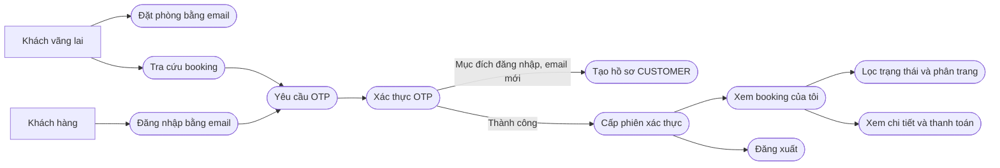
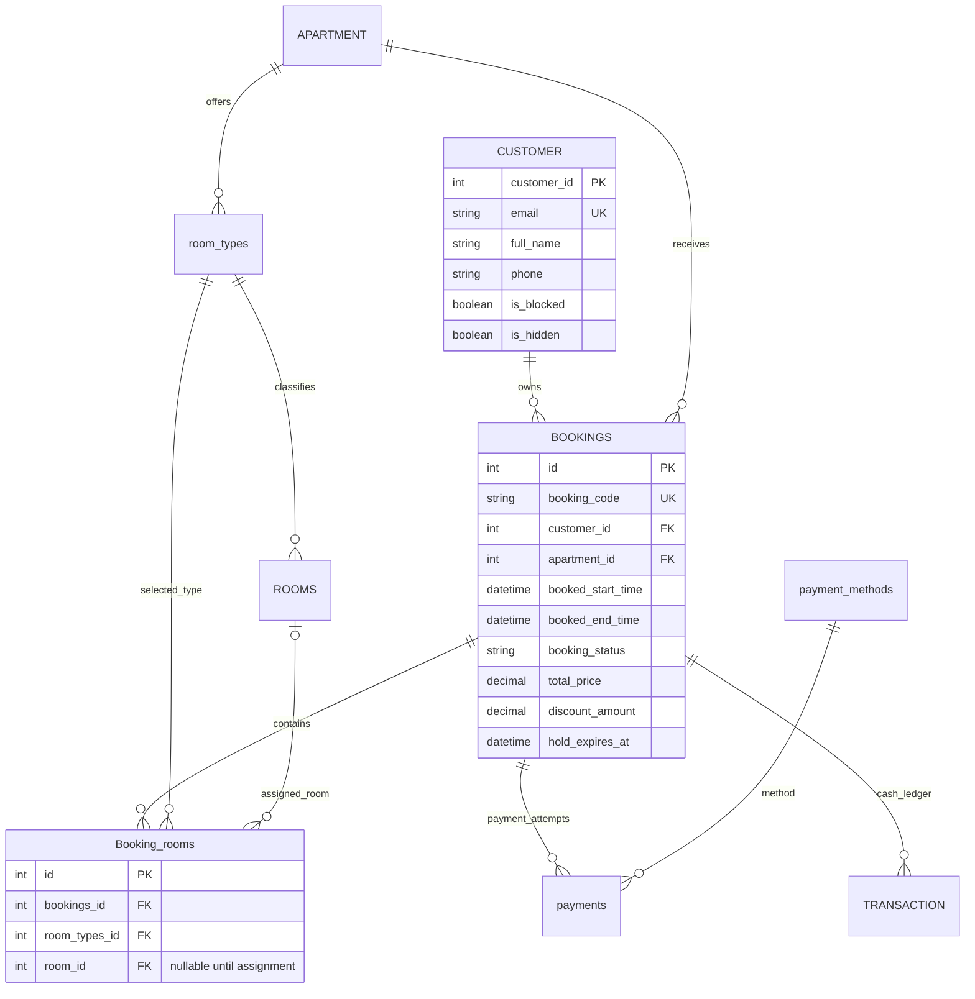
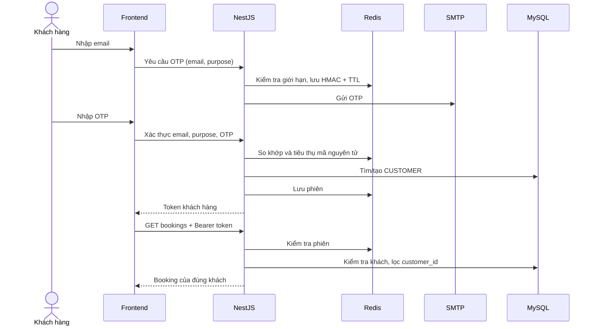

# Tài khoản khách hàng và tra cứu booking

> **Thiết kế hiện tại (07/11/2026):** tài khoản đăng ký/đăng nhập bằng email + mật khẩu, xác minh/reset bằng liên kết email; OTP chỉ cho khách vãng lai tra cứu/đặt phòng. Xem [CUSTOMER_ACCOUNT_V2.md](CUSTOMER_ACCOUNT_V2.md) và [use case/ERD đã cập nhật](customer-account.drawio). Các mô tả đăng nhập tài khoản bằng OTP dưới đây là tài liệu phiên bản cũ, đã được thay thế.

Ngày cập nhật: 06/11/2026. Phạm vi triển khai: email + OTP, xem danh sách/chi tiết booking, lọc trạng thái, phân trang, đăng xuất và tra cứu của khách vãng lai.

Bản sơ đồ có thể mở/chỉnh sửa trong diagrams.net: [customer-account.drawio](customer-account.drawio), gồm hai trang use case client và ERD của phần tài khoản/booking.

## Quy tắc nghiệp vụ

- `CUSTOMER` là danh tính người đặt, kể cả khi họ chưa từng đăng nhập. Không thêm bảng tài khoản khách hàng hay mật khẩu vào bảng này.
- Email được trim và chuyển chữ thường trước khi tra cứu/tạo hồ sơ. Dùng ràng buộc unique hiện có của `CUSTOMER.email` để chống tạo trùng. Không tự đổi tên/số điện thoại của hồ sơ cũ khi người khác nhập cùng email ở checkout.
- Đặt phòng với tư cách khách vãng lai tạo/tìm `CUSTOMER` rồi lưu `BOOKINGS.customer_id`. Email người nhận khóa hoặc người lưu trú không quyết định quyền sở hữu đơn.
- Đăng nhập lần đầu bằng OTP hợp lệ có thể tạo hồ sơ khách hàng. Tra cứu không tự tạo hồ sơ mới; nếu chưa có hồ sơ tương ứng, chỉ thông báo sau khi đã xác thực OTP.
- Khách hàng bị khóa/ẩn không thể đăng nhập hoặc dùng phiên đã cấp. Mỗi lần truy cập đều kiểm tra trạng thái hồ sơ.
- Tra cứu và đăng nhập dùng chung hạ tầng xác thực nhưng OTP được ràng buộc với mục đích `lookup` hoặc `account`. Cả hai phiên hiện chỉ có quyền đọc hồ sơ tối thiểu và booking của chính mình.
- Không tìm booking bằng email lấy từ query/body sau khi đăng nhập. Backend lấy `customer_id` từ phiên đã xác thực và đưa điều kiện sở hữu vào truy vấn.

## Use case client cập nhật

Các use case ngoài phạm vi như Chat AI, xem/tìm phòng vẫn giữ nguyên. `Đăng ký` thủ công bằng mật khẩu được thay bằng nhánh tạo hồ sơ tại lần đăng nhập OTP đầu tiên.



Sơ đồ trên diễn tả luồng, không dùng mũi tên luồng để thay thế ký hiệu UML `include`/`extend`. Tiền điều kiện của xem booking là có phiên hợp lệ; không bắt khách đăng nhập lại mỗi lần xem một đơn.

### UC-C01: Đăng nhập email + OTP

1. Nhập email và yêu cầu mã. Backend trả thông báo gửi mã mà không tiết lộ email có hồ sơ hay không.
2. Mã 6 chữ số được gửi bằng SMTP, hiệu lực 5 phút, không xuất hiện trong API response hoặc log ứng dụng.
3. Nhập mã. Nếu đúng, tiêu thụ mã một lần, tìm/tạo hồ sơ và cấp phiên 2 giờ.
4. Ngoại lệ: email sai định dạng (400), sai/hết hạn/đã dùng mã (401), quá giới hạn (429), Redis/SMTP lỗi (503), tài khoản bị khóa (401).

### UC-C02: Booking của tôi

1. Từ phiên đã xác thực, tải tối đa 10 booking mỗi trang, mới nhất trước.
2. Lọc theo trạng thái. Có loading, trạng thái rỗng, lỗi và nút làm mới; không thay lỗi bằng dữ liệu mẫu.
3. Xem chi tiết gồm chi nhánh, phòng/loại phòng, nhận/trả phòng, số khách, tổng tiền, giảm giá và lịch sử thanh toán.
4. Đơn không tồn tại và đơn của khách khác cùng trả 404. API không trả ảnh/số CCCD, hồ sơ người lưu trú, mã PIN hay master PIN.

### UC-C03: Tra cứu khách vãng lai

Nhập đúng email người đặt → yêu cầu OTP với `purpose=lookup` → xác thực → danh sách booking gắn với `CUSTOMER`. Không có luồng nhập email rồi xem đơn ngay.

### UC-C04: Đăng xuất

Backend xóa phiên Redis. Frontend xóa token riêng của khách trong `localStorage` và token `sessionStorage` cũ; token đã thu hồi không gọi API được nữa. Phiên được khôi phục qua API `/customer/me` khi tải lại trang, còn hiệu lực tối đa 2 giờ và đồng bộ đăng nhập/đăng xuất giữa các tab cùng origin. Token này không dùng chung với token admin/legacy.

## ERD của phần được triển khai

Đây là sơ đồ bổ sung cho phần tài khoản/booking, không thay thế toàn bộ ERD gốc. Tên khóa phản ánh entity đang chạy local; ví dụ `BOOKINGS.id` tương ứng `bookings_id` ở bản ERD được cung cấp.



`CUSTOMER → BOOKINGS` dùng 1–0..n vì khách có thể đăng nhập trước khi đặt phòng. Schema legacy còn cho phép booking có `customer_id` null; đơn tạo qua API mới luôn gắn khách. Không tự gán các đơn cũ thiếu email/chủ sở hữu bằng suy đoán. Cần đối soát dữ liệu cũ trước khi chuyển khóa này thành NOT NULL ở toàn bộ hệ thống.

Không có migration bảng OTP: Redis là kho tạm ngoài ERD MySQL. Không sửa file ERD tải về của người dùng. Sơ đồ mới này ghi rõ quan hệ áp dụng cho phần triển khai; các khác biệt khác giữa backend và ERD gốc cần chốt riêng với nhóm BE.

## Redis và phiên xác thực

| Khóa | Nội dung | TTL/quy tắc |
|---|---|---|
| `customer:otp:{purpose}:{emailHmac}` | JSON gồm HMAC của email+mục đích+mã, số lần thử | 300 giây; tối đa 5 lần nhập sai |
| `customer:cooldown:{emailHmac}` | Đánh dấu thời điểm gửi | 60 giây, dùng chung hai mục đích |
| `customer:rate:email:{emailHmac}` | Số lần gửi theo email | Tối đa 10/giờ |
| `customer:rate:ip:{ipHmac}` | Số lần yêu cầu theo IP | Tối đa 30/giờ |
| `customer:session:{jti}` | ID khách hàng | 7200 giây, xóa khi logout |

Mã dùng `crypto.randomInt`; HMAC-SHA256 dùng `JWT_SECRET`. So khớp, tăng lần thử và tiêu thụ mã bằng một Lua script Redis để hai request đồng thời không dùng lại một mã. Redis lỗi thì từ chối xác thực, không có mã dự phòng hoặc OTP cố định. JWT chứa loại `customer`, scope, ID phiên và ID khách; backend kiểm tra cả chữ ký, hạn, Redis và hồ sơ. JWT legacy không được dùng cho các API mới và token khách không được dùng vào auth legacy.



## API

Tiền tố `/api/customer`:

| Method | Đường dẫn | Nội dung |
|---|---|---|
| POST | `/auth/otp/request` | `{email, purpose: account hoặc lookup}` |
| POST | `/auth/otp/verify` | `{email, purpose, code}` |
| GET | `/me` | Hồ sơ tối thiểu; cần token khách |
| POST | `/auth/logout` | Thu hồi phiên; cần token khách |
| GET | `/bookings?status=&page=1` | Danh sách 10 đơn/trang; cần token khách |
| GET | `/bookings/:id` | Chi tiết đơn thuộc khách; cần token khách |
| POST | `/guest-bookings` | Lưu đơn khách vãng lai vào MySQL, không cần đăng nhập |

API khách vãng lai hiện nhận một loại phòng mỗi đơn, số phòng, người lớn/trẻ em, ngày nhận/trả phòng và thông tin người đặt. Giá tính bằng giá cơ sở × số đêm × số phòng trên backend; không tin giá frontend. Khóa dòng loại phòng trong transaction, kiểm tra sức chứa/số phòng trống, tạo `BOOKINGS` và `Booking_rooms` nguyên tử, giữ phòng 15 phút. Chưa áp dụng voucher, phụ phí, nhiều loại phòng trong một đơn, lưu giấy tờ hoặc thu tiền trong luồng mới. Frontend hiển thị chờ thanh toán, không tự đánh dấu đã thanh toán hoặc đã cấp PIN.

Sổ `TRANSACTION` là nguồn tiền khi có bản ghi; không cộng chồng tổng từ `payments` vì có thể cùng một khoản thu. Nếu không có sổ giao dịch, lấy các `payments` ở trạng thái `paid`. Số còn lại = max(0, tổng đơn − tiền thu ròng), không phải cam kết phí hủy/hoàn tiền cuối cùng.

## Chạy và kiểm tra local

```powershell
docker compose up -d --wait
cd project/backend
npm install
npm run build
npm run start:prod
# Terminal khác, cùng thư mục backend:
npm run test:customer
```

- Tài khoản: http://localhost/account (theo cổng Vite hiện tại là 80).
- Tra cứu: http://localhost/booking-lookup.
- OTP hiện được gửi qua SMTP thật. Mailpit đã được bỏ khỏi Docker Compose; nếu chạy test tích hợp bên dưới, cần tự cung cấp Mailpit riêng và trỏ SMTP của backend tới đó.
- SMTP dùng các biến `SMTP_HOST`, `SMTP_PORT`, `SMTP_SECURE`, `SMTP_USER`, `SMTP_PASS`, `SMTP_FROM`. Mailpit local: host `127.0.0.1`, port `1025`, secure `false`, để trống user/pass. Gmail: host `smtp.gmail.com`, port `587`, secure `false` (STARTTLS), user là địa chỉ Gmail, pass là mật khẩu ứng dụng; hoặc port `465` với secure `true`. Không cần URL-encode mật khẩu. Production bắt buộc user/pass SMTP, JWT_SECRET riêng, Redis có bảo vệ và frontend qua HTTPS. Không commit thông tin SMTP thật.
- Nếu đặt reverse proxy, cấu hình trust proxy đúng dải tin cậy trước khi dùng giới hạn IP ở môi trường đó; không tin header IP tùy ý từ client.
- Test tích hợp dùng MySQL, Redis và Mailpit local; tạo fixture email ngẫu nhiên rồi xóa đúng fixture trong finally. Không gọi TTLock/PayOS hoặc gửi email bên ngoài.

## Phạm vi tiếp theo

Đã bổ sung cập nhật hồ sơ, xem PIN có điều kiện và gửi/theo dõi yêu cầu hủy/hoàn, gia hạn, đổi phòng. Xem [phần triển khai quản lý khách hàng và đối chiếu ERD](CUSTOMER_MANAGEMENT.md). Thanh toán PayOS thật và tự động thực thi yêu cầu chưa triển khai. Đăng ký/đăng nhập password legacy và xác thực quản trị vẫn cần kế hoạch chuyển đổi riêng.

Đã fetch `origin/ha/backend` tại commit `dc774cf4`. Remote được force-update và layout repo khác local; không merge/reset tự động workspace có thay đổi sẵn. Module auth trong snapshot remote và HEAD không có khác biệt; phần mới nằm ở module customer độc lập.

## Ghi chú giao diện

Áp dụng `editorial-greeting`, seed ghi trong `.taste-skill/customer-account/direction.json`, giữ palette/type sẵn có. Nền kem và chữ nâu là thương hiệu hiện hữu; nội dung chính là danh sách chuyến đi và thông tin đơn đang chọn. Câu hỏi của màn hình: “Tôi đã đặt những đơn nào và trạng thái hiện tại là gì?”. Không có số liệu, booking, ảnh hoặc mã PIN mẫu ở màn hình tài khoản mới. Loại footer marketing và nút liên hệ nổi khỏi hai màn hình này để không che biểu mẫu trên điện thoại.

Inspector cho phép `micro-label`, `emoji`, `palette-claude`, `heavy-shadow`, `font-count`, `icon-chips` vì đây là chrome/logo/palette hiện hữu của Navbar chung, không phải thành phần mới của tài khoản. Đã sửa lỗi logo bị che trên mobile và menu ẩn vẫn có thể được focus. Khoảng trống dưới form OTP là chủ ý của màn hình xác thực ít nội dung; không thêm dữ liệu giả để lấp khoảng trống. Ảnh QA xác thực dùng fixture thử được xóa sau test.

Kết quả kiểm tra ngày 06/11/2026: backend/frontend build thành công; 34 kiểm tra HTTP tích hợp đạt, bao gồm chặn đặt vượt số phòng khi có đơn legacy; kiểm tra browser hiển thị booking đã lưu, mở chi tiết và không tràn ngang trên mobile đạt. Inspector trên production preview tại 1440/768/390px không có lỗi bắt buộc sau các ngoại lệ Navbar trên; còn cảnh báo tương phản nút Đặt phòng sẵn có (4.4:1) và khoảng trống dưới biểu mẫu xác thực. Style seed: `130375119`, không redraw.
