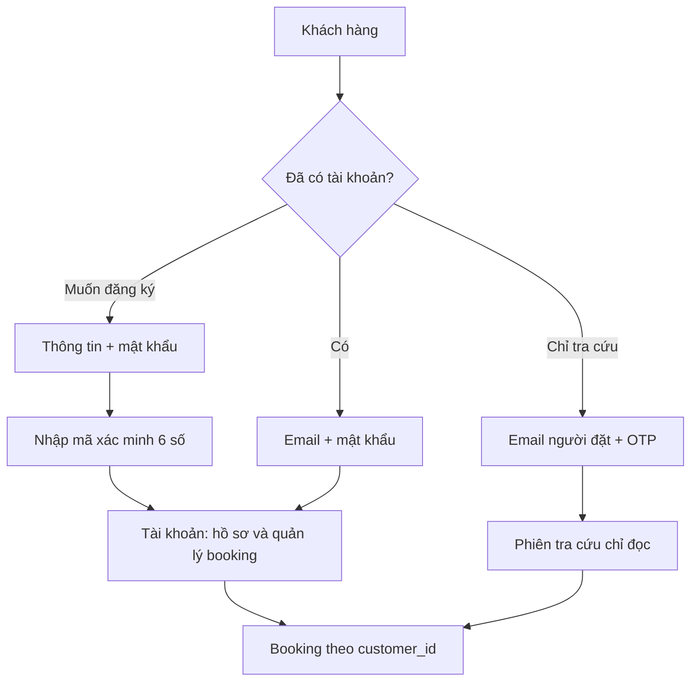

# Tài khoản khách hàng và khách vãng lai — thiết kế đang triển khai

Cập nhật ngày 07/11/2026. Tài khoản đăng nhập bằng mật khẩu; xác minh đăng ký/reset dùng mã 6 số đọc được trên điện thoại và nhập ngay ở trang đang mở, không bấm liên kết localhost. Xác minh đăng ký thành công sẽ tự vào tài khoản.

## Hai phần độc lập

| Nội dung | Khách có tài khoản | Khách vãng lai |
| --- | --- | --- |
| Trang | `/account` | `/booking-lookup` |
| Tạo tài khoản | Họ tên, email, mật khẩu; số điện thoại không bắt buộc | Không cần tạo tài khoản để đặt phòng/tra cứu |
| Xác minh | Mã email 6 số khi đăng ký/reset, hiệu lực 5 phút | OTP email, hiệu lực 5 phút |
| Đăng nhập | Email + mật khẩu | Email + OTP, cấp phiên tra cứu chỉ đọc |
| Hồ sơ | Xem/sửa tên, số điện thoại; email là định danh đã xác minh | Chỉ hiển thị thông tin tối thiểu cần tra cứu |
| Booking | Xem, lọc, phân trang, chi tiết, lịch sử thanh toán/hoàn | Xem các đơn và chi tiết của email đã xác thực |
| Tác vụ | Xem PIN đủ điều kiện; gửi/theo dõi yêu cầu hủy/hoàn, gia hạn, đổi phòng | Không sửa hồ sơ, không gửi yêu cầu quản lý hoặc xem PIN |
| Bảo mật | Đổi mật khẩu, quên/đặt lại mật khẩu, đăng xuất | Kết thúc phiên tra cứu; không làm mất phiên tài khoản |
| Lưu phiên trình duyệt | `localStorage.customer_token` | `sessionStorage.customer_lookup_token` |

Cả hai phiên có hạn 2 giờ và luôn được kiểm tra bằng chữ ký JWT + phiên Redis. Token phía trình duyệt chỉ là thông tin phiên, không tự quyết định quyền; backend kiểm tra `scope` và quyền sở hữu booking. OTP mục đích `account` đã bị loại khỏi API. OTP `lookup` dùng cho tra cứu; OTP `booking` chỉ xác minh email khách khi đặt phòng và cũng chỉ cấp scope lookup.

## Use case được cập nhật

### UC-C04 — Đăng ký tài khoản

1. Khách nhập họ tên, email, mật khẩu và có thể nhập số điện thoại.
2. Kiểm tra dữ liệu; mật khẩu từ 8 ký tự, tối đa 72 byte; băm bằng bcrypt cost 12.
3. Lưu đăng ký chờ xác minh trong Redis 30 phút; gửi mã 6 số có hiệu lực 5 phút. Giao diện chuyển sang nhập mã, không giữ biểu mẫu mật khẩu trống. Chưa thay đổi danh tính hay quyền quản lý của khách chỉ vì người khác điền email đó.
4. Khách đọc mã trên điện thoại hoặc máy tính và nhập ngay tại trang đăng ký. Mã được lưu HMAC, dùng một lần, tối đa 5 lần sai. Có gửi lại mã và đổi email; gửi lại không cần nhập lại mật khẩu khi yêu cầu đăng ký còn hiệu lực.
5. Nếu email đã có CUSTOMER do từng đặt vãng lai, cập nhật thông tin tài khoản vào đúng hàng đó. Giữ nguyên customer_id và mọi booking cũ.
6. Nếu email chưa có CUSTOMER, tạo một hồ sơ. Lưu password_hash, account_created_at, email_verified_at và cấp phiên account ngay sau xác minh. Các lần sau đăng nhập bằng email + mật khẩu.

Email đã có tài khoản không bị ghi đè bởi yêu cầu đăng ký mới; phản hồi công khai dùng thông báo chung. Email có unique constraint; kích hoạt dùng transaction và khóa dòng để tránh tạo hai tài khoản trùng.

### UC-C05 — Đăng nhập tài khoản

Nhập email + mật khẩu → kiểm tra bcrypt, email đã xác minh, không bị chặn/ẩn → cấp scope account → hiển thị hồ sơ và booking của customer_id đó. Không yêu cầu OTP đăng nhập cho tài khoản. Thông báo sai mật khẩu không tiết lộ chắc chắn email có tài khoản hay chưa.

### UC-C05a — Quên/đặt lại mật khẩu

Nhập email → nếu có tài khoản hợp lệ thì gửi mã 6 số → nhập mã và mật khẩu mới ngay trên trang đó → mã 5 phút, dùng một lần, tối đa 5 lần sai → lưu mật khẩu băm mới → đăng nhập lại. Mã reset ràng buộc với phiên bản thông tin đăng nhập, nên yêu cầu reset cũ không dùng được sau khi mật khẩu đã đổi. Không gửi liên kết mới qua email.

### UC-C05b — Đổi mật khẩu

Phải có phiên account và nhập đúng mật khẩu hiện tại. Khi đổi thành công, mọi phiên account có phiên bản mật khẩu cũ bị từ chối ở lần gọi API tiếp theo. Phiên tra cứu vãng lai là quyền đọc độc lập, không trở thành tài khoản và không được gọi đổi mật khẩu.

### UC-C06 — Đăng xuất

Thu hồi đúng jti ở Redis và xóa đúng token trình duyệt. Đăng xuất tra cứu không đăng xuất tài khoản đang mở; đăng xuất tài khoản không dùng token tra cứu để thay thế. Lỗi mạng không bị hiểu nhầm là đã thu hồi phiên server.

### UC-C07 — Quản lý booking trong tài khoản

Xem danh sách/trạng thái, lọc/phân trang; xem chi tiết phòng/ngày ở, thanh toán/hoàn; xem PIN đủ điều kiện; gửi và theo dõi yêu cầu hủy/hoàn, đổi phòng, gia hạn. Nhân viên tiếp nhận/phản hồi trong màn hình quản lý Booking. Chi tiết điều kiện và bảng booking_requests: [CUSTOMER_MANAGEMENT.md](CUSTOMER_MANAGEMENT.md).

Yêu cầu hỗ trợ không tự thực thi hủy, hoàn tiền, đổi phòng hoặc gia hạn. Phải kiểm tra tồn phòng, chi phí và nghiệp vụ khóa trước khi nhân viên thực hiện. Không tạo liên kết thanh toán PayOS giả.

### UC-C09 — Tra cứu khách vãng lai

Email người đặt → OTP đúng mục đích lookup → xác thực một lần → phiên chỉ đọc các booking của email đó. Không yêu cầu mật khẩu hoặc đăng ký. Không tự tạo tài khoản đăng ký từ OTP. Nếu chưa có hồ sơ/booking thì thông báo sau khi xác thực, không trả dữ liệu người khác. Biết email của người khác không đủ để xem đơn.



## ERD và migration

Sơ đồ chỉnh sửa được: [customer-account.drawio](customer-account.drawio), gồm ba trang: use case tài khoản, use case khách vãng lai, ERD phạm vi thực hiện. ERD gốc được giữ tại [erd-customer-reference.drawio](erd-customer-reference.drawio).

Bổ sung trực tiếp vào CUSTOMER: password_hash nullable (select:false), account_created_at nullable, email_verified_at nullable. Khách vãng lai có thể đã có CUSTOMER và booking nhưng password_hash vẫn NULL. Không tạo thêm bảng tài khoản trùng danh tính và không đổi BOOKINGS.customer_id khi khách đăng ký.

Đăng ký chờ xác minh, token xác minh/reset và OTP nằm trong Redis, không thêm bảng OTP hoặc lưu mật khẩu thô. Mật khẩu/hash/token xác minh không xuất hiện trong API hồ sơ hay log. Khóa phiên account mang dấu phiên bản mật khẩu để đổi/reset mật khẩu vô hiệu hóa phiên cũ.

Chạy migration bổ sung idempotent, không reset dữ liệu:

```powershell
npm run db:customer-management --prefix project/backend
```

SMTP dùng SMTP_HOST/PORT/SECURE/USER/PASS/FROM hiện có. Xác minh đăng ký và reset mới không phụ thuộc URL localhost hay thiết bị mở email. Endpoint nhận liên kết cũ được giữ để tương thích các email đã gửi trước khi đổi sang mã.

## API

Tất cả dưới `/api/customer`:

- `POST /auth/register`, `/auth/resend-verification`, `/auth/verify-email`, `/auth/login`.
- `POST /auth/forgot-password`, `/auth/reset-password`, `/auth/change-password`.
- `POST /auth/otp/request`, `/auth/otp/verify` cho lookup/booking.
- `GET/PUT /me`, `POST /auth/logout`.
- `GET /bookings`, `/bookings/:id`, `/bookings/:id/requests`.
- Scope account: `POST /bookings/:id/requests`, `GET /bookings/:id/pins`, `/bookings/:id/room-options`.

OTP: 60 giây/lần, 10/email/giờ, 30/IP/giờ, tối đa 5 lần nhập sai. Đăng ký/quên mật khẩu: 5 yêu cầu/email/giờ và giới hạn IP; đăng nhập: 10 lần/email/15 phút và giới hạn IP. Đổi mật khẩu yêu cầu phiên account và giới hạn thử mật khẩu hiện tại.

Đăng ký có nút gửi lại mã sau 60 giây. Mỗi lần gửi lại thay mã trước và đặt lại giới hạn 5 lần sai. Chỉ email, loại bước và thời gian chờ được nhớ ở trình duyệt khi reload; không lưu mật khẩu hoặc mã thô. Phiên account cũ từng được cấp qua OTP trước đợt điều chỉnh này không còn được coi là tài khoản đã đăng ký: khách tạo tài khoản bằng đúng email cũ để giữ các đơn đã có.

## Kiểm tra

```powershell
npm run build --prefix project/backend
npm run test:customer-accounts --prefix project/backend
npm run test:customer-management --prefix project/backend
npm run build --prefix project/frontend
npm run test:session --prefix project/frontend
```

Các test tạo fixture riêng, bắt email trong transport thử và dọn dữ liệu sau test; không gửi email, thanh toán hoặc điều khiển khóa thật. Test mới kiểm tra đăng ký/kích hoạt, liên kết đơn vãng lai cũ, đăng nhập/sửa hồ sơ, đổi/reset mật khẩu, token dùng một lần, vô hiệu hóa phiên cũ, quyền lookup/account và đăng xuất độc lập.

Kết quả: 47 kiểm tra HTTP vòng đời tài khoản + 35 kiểm tra HTTP quản lý booking đều đạt. Trình duyệt đã chạy đăng ký, chuyển sang nhập mã mà không hỏi lại mật khẩu, reload khi chờ mã, tự đăng nhập sau xác minh, sửa hồ sơ, OTP vãng lai, tách phiên, đổi/reset mật khẩu; không có lỗi JavaScript hoặc tràn ngang tại 1440/768/390 px. Fixture được dọn sau kiểm tra.

Giao diện tiếp tục hướng `editorial-greeting`, seed `1218517289`, giữ palette/type thương hiệu, không redraw. Nội dung chính là booking của khách, biểu mẫu hồ sơ và bảo mật; không thêm số liệu trang trí. Inspector bản build không có lỗi bắt buộc khi giữ ngoại lệ palette thương hiệu; còn ba cảnh báo của Navbar chung: nhãn hotline, font và tương phản nút Đặt phòng. Ảnh kiểm tra lưu trong `.taste-skill/customer-account/password-qa/` và `password-production/`.

Thiết kế tham khảo cách tách khu vực tài khoản/booking và truy cập thông tin đơn qua kênh xác nhận của [Booking.com](https://www.booking.com/tpi_faq.en-gb.html) và [Agoda](https://www.agoda.com/info/contact.html). Cơ chế email + mật khẩu / OTP cụ thể ở đây là lựa chọn cho project theo yêu cầu, không khẳng định hai dịch vụ có cùng cơ chế.

Giới hạn hiện hữu: chưa tích hợp thanh toán PayOS thật trong tài khoản, chưa tự động thực thi yêu cầu thay đổi booking; xác thực quản trị còn dùng cơ chế demo x-staff-* và cần thay trước khi công khai. Phiên frontend hiện dùng token trong trình duyệt, chưa chuyển sang cookie HttpOnly.
