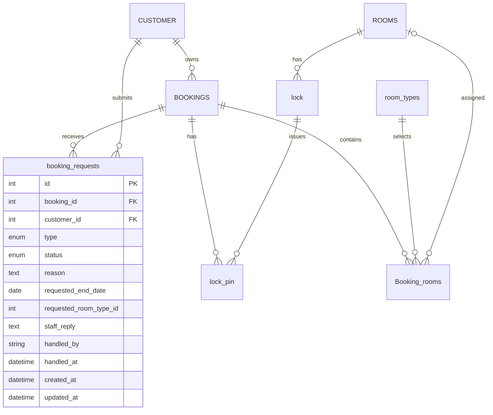

# Quản lý tài khoản và booking của khách hàng

Cập nhật: 07/11/2026. Truy cập: `http://localhost/account`.

## Đối chiếu use case và ERD được cung cấp

Đã đọc sơ đồ use case Client trong yêu cầu và toàn bộ 513 cell của ERD draw.io đính kèm. Bản sao ERD gốc được giữ tại [erd-customer-reference.drawio](erd-customer-reference.drawio); không sửa sơ đồ gốc để che khác biệt với schema đang chạy.

| Use case / dữ liệu gốc | Triển khai |
| --- | --- |
| Đăng ký, đăng nhập, đăng xuất | Tài khoản dùng email + mật khẩu; xác minh email bằng liên kết. Khách vãng lai dùng OTP, không tự tạo tài khoản. Bổ sung password_hash, account_created_at, email_verified_at vào CUSTOMER. Hai phiên lưu riêng, hạn 2 giờ; xem [thiết kế mới](CUSTOMER_ACCOUNT_V2.md). |
| Hồ sơ khách: `customer_id`, `full_name`, `email`, `phone` | Sửa tên/số điện thoại của chính mình; email giữ cố định vì là danh tính đã xác thực và sở hữu booking. Không cho sửa cờ chặn/ẩn hoặc khách khác. |
| `CUSTOMER` → `BOOKINGS.customer_id` | Liệt kê, lọc trạng thái, phân trang, xem chi tiết/lịch sử đơn của đúng khách đăng nhập. API luôn giới hạn theo customer_id từ phiên; không tin ID/email gửi từ frontend để cấp quyền. |
| `Booking_rooms` → `room_types`, `ROOMS` | Hiển thị loại phòng và số phòng đã phân; chưa phân phòng thì thể hiện rõ. |
| Thanh toán / giao dịch | Hiển thị khoản đã thu, hoàn, số còn lại, lịch sử giao dịch và trạng thái hoàn tiền; dùng dữ liệu thật. Không tự tạo liên kết PayOS giả. |
| `lock-pin` → booking, khóa và phòng | Endpoint riêng để xem mã đang hoạt động; không đưa PIN vào API danh sách/chi tiết thông thường. Không trả cloud_pw_id hoặc master PIN. |
| Hủy/hoàn, gia hạn lưu trú, đổi phòng | Tạo yêu cầu lưu bền trong MySQL; nhân viên tiếp nhận/phản hồi trong màn hình quản lý Booking; khách xem lịch sử và phản hồi. |

ERD gốc gọi PK của `BOOKINGS` là `bookings_id`, còn entity/schema đang chạy dùng `BOOKINGS.id`. Bảng `Booking_rooms` dùng FK `bookings_id`. Mã triển khai theo tên cột thực tế, không đổi tên/xóa dữ liệu cũ. ERD gốc chưa có bảng yêu cầu hoặc luồng duyệt, nên bổ sung bảng `booking_requests` thay vì nhét yêu cầu vào tên khách, ghi đè booking hoặc giả giao dịch hoàn tiền.



## Quy tắc nghiệp vụ đã triển khai

- Phiên `account` được sửa hồ sơ, gửi yêu cầu và xem PIN. Phiên `lookup` chỉ đọc hồ sơ tối thiểu, booking và lịch sử yêu cầu; không có quyền sửa hoặc xem mã khóa.
- Yêu cầu gồm `cancel`, `refund`, `extend`, `change_room`. Trạng thái xử lý: `pending` → `reviewing` → `resolved`/`rejected`; có thể phản hồi kết thúc trực tiếp từ pending. Yêu cầu đã kết thúc không được sửa tiếp.
- Chặn gửi trùng loại khi yêu cầu trước còn pending/reviewing. Khóa dòng booking trong transaction để hai lần nhấn đồng thời không tạo yêu cầu trùng.
- Hủy: đơn còn hoạt động, chưa đến giờ nhận phòng và chưa check-in. Đơn đã đến giờ lưu trú cần liên hệ lễ tân.
- Hoàn tiền: phải có khoản đã thu ròng dương. Đây là yêu cầu xem xét, chưa phải giao dịch hoàn tiền hoặc cam kết hoàn đủ.
- Gia hạn/đổi phòng: booking đã xác nhận hoặc đang lưu trú, chưa kết thúc. Ngày gia hạn phải sau ngày trả phòng hiện tại và không quá 90 ngày gia hạn; loại phòng mới phải đang hoạt động, cùng chi nhánh và đủ sức chứa theo số phòng của đơn. Tồn phòng thực tế và chênh lệch tiền cần nhân viên xác nhận trước khi thực hiện nghiệp vụ.
- Không tự chuyển booking sang cancelled, đổi lịch/phòng, cấp/thu hồi PIN hoặc hoàn tiền khi gửi yêu cầu hay khi đánh dấu đã phản hồi. Nhân viên thực hiện nghiệp vụ tương ứng, rồi phản hồi kết quả rõ ràng cho khách. Chưa đặt ra phí/hạn hoàn tiền vì sơ đồ chưa quy định chính sách đó.
- PIN: đúng chủ đơn, phiên account, booking confirmed/checked_in, giấy tờ passed, đã thanh toán đủ giá trị dương, đang trong thời gian lưu trú; chỉ lấy mã active chưa hết hạn gắn với phòng đã phân của booking. Ghi audit không chứa PIN; phản hồi `Cache-Control: no-store`; giao diện tự ẩn mã sau tối đa 60 giây.
- Danh sách yêu cầu của nhân viên giới hạn theo chi nhánh trong StaffContext; phản hồi có audit. Luồng quản trị tiếp tục dùng cơ chế phân quyền demo hiện hữu của project (header x-staff-*). Phải thay bằng xác thực nhân viên thực trước khi đưa lên môi trường công khai.

## Cài đặt, API và kiểm tra

Sau khi cập nhật mã nguồn, chạy trong `project/backend`:

```powershell
npm run db:customer-management
npm run build
npm run test:customer-management
```

Migration chỉ tạo bảng mới nếu chưa tồn tại; không dùng synchronize/reset với dữ liệu cũ. `db:init:local` đã đọc entity mới cho database hoàn toàn mới; database đang có dữ liệu phải chạy migration bổ sung ở trên.

API mới dưới `/api/customer`: `PUT /me`; `GET/POST /bookings/:id/requests`; `GET /bookings/:id/room-options`; `GET /bookings/:id/pins`. API quản trị: `GET /api/admin/customer-requests`, `PUT /api/admin/customer-requests/:id`. Tên/số điện thoại được whitelist, validate và ràng buộc theo phiên; không cho tự đổi email.

Test tích hợp tạo fixture riêng trong MySQL/Redis, bắt email ở transport thử, không gửi mail thật hoặc gọi TTLock/PayOS và dọn fixture trong finally. Đã kiểm tra 35 phản hồi HTTP và các nhánh quyền sở hữu, giới hạn lookup, dữ liệu hồ sơ, gửi trùng, phạm vi chi nhánh, vòng đời yêu cầu, điều kiện thanh toán/PIN và đăng xuất. Giao dịch và chứng từ hoàn tiền được đối chiếu để không cộng/trừ hai lần; PIN bị chặn khi khoản hoàn đã làm số tiền ròng thấp hơn giá trị đơn. Kiểm tra phiên frontend: `npm run test:session` trong `project/frontend`.

## Giao diện và kiểm tra trực quan

Giữ palette/type của Đồi Bông Gòn, dùng hướng `editorial-greeting`, seed `1218517289`, không redraw. Nội dung chính là chuyến đi của khách; hồ sơ và chi tiết booking là các biểu mẫu/phần việc thực, không có số liệu trang trí. Câu hỏi chính: “Tôi có những booking nào, còn việc gì cần xử lý?”. Hồ sơ trả lời “Thông tin người đặt của tôi đã đúng chưa?”.

Đã dùng trình duyệt kiểm tra lưu hồ sơ rồi reload, gửi yêu cầu, phản hồi của nhân viên và khách nhận phản hồi; không có lỗi JavaScript ở trang tài khoản hay tràn ngang ở 1440/768/390. Các fixture UI được xóa sau khi chạy. Style lint không có lỗi. Inspector giữ ngoại lệ palette thương hiệu sẵn có; còn cảnh báo từ Navbar chung (nhãn hotline, font, tương phản nút Đặt phòng) và khoảng trống chủ ý dưới form OTP. Không thêm booking/PIN giả để lấp màn hình xác thực.

Giới hạn: chưa tích hợp thanh toán PayOS thật trong tài khoản; chưa tự động duyệt/thực thi yêu cầu thay đổi hoặc hoàn tiền. Giao diện không báo thanh toán/hoàn/đổi/gia hạn thành công khi mới gửi hoặc phản hồi yêu cầu.
