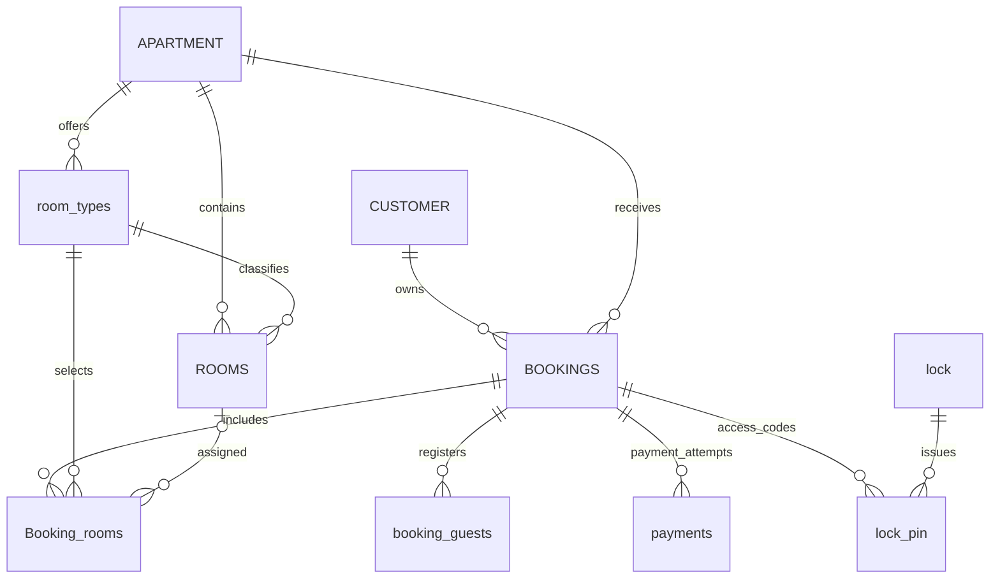

# ĐẶC TẢ USE CASE CLIENT VÀ ADMIN — HỆ THỐNG HOMESTAY

> **Điều chỉnh 07/11/2026:** phần đăng ký/đăng nhập Client bằng OTP trong đặc tả cũ được thay bởi email + mật khẩu và xác minh email qua liên kết. OTP chỉ dành cho khách vãng lai. Đặc tả hiện hành, quyền hai nhóm và các use case quên/đổi mật khẩu: [CUSTOMER_ACCOUNT_V2.md](CUSTOMER_ACCOUNT_V2.md). Sơ đồ chỉnh sửa tương ứng: [customer-account.drawio](customer-account.drawio). Các phần quản lý booking và Admin vẫn dùng các quy tắc nghiệp vụ mô tả bên dưới khi không xung đột với điều chỉnh này.

Ngày biên soạn: 06/11/2026  
Phiên bản: 1.0  
Nguồn: hai ảnh sơ đồ use case Client/Admin được cung cấp trong cuộc hội thoại; yêu cầu email + OTP và tra cứu booking của khách vãng lai; tài liệu `CUSTOMER_ACCOUNT.md` trong dự án.

> Đây là đặc tả yêu cầu để phân tích, thiết kế và kiểm thử. Việc một chức năng xuất hiện ở đây không có nghĩa chức năng đã được triển khai hoặc đã kiểm thử thành công. Các chính sách chưa có trong nguồn được ghi là **đề xuất/cần chốt**, không tự coi là yêu cầu đã duyệt.

## 1. Mục đích và phạm vi

Hệ thống hỗ trợ khách tìm phòng, đặt phòng, truy cập booking cá nhân và sử dụng các thông tin nhận phòng. Phía quản trị quản lý chi nhánh, phòng, khách hàng, nhân viên, booking, voucher và mã vào cửa.

Tài liệu làm rõ:

- Tác nhân, mục tiêu và phạm vi của từng use case trong hai sơ đồ.
- Tiền điều kiện, hậu điều kiện, luồng chính và các trường hợp ngoại lệ.
- Quy tắc về quyền truy cập, trạng thái booking, thanh toán và mã khóa.
- Phần thay đổi khi chuyển từ đăng ký truyền thống sang đăng nhập email + OTP.
- Những điểm phải thống nhất với use case, ERD và backend trước khi triển khai.

Không đặc tả chi tiết giao thức TTLock, hợp đồng thanh toán PayOS hoặc thuật toán AI. Không tự bổ sung chức năng đánh giá phòng chỉ vì sơ đồ có yêu cầu hiển thị đánh giá.

## 2. Tác nhân và thuật ngữ

| Tác nhân/thuật ngữ | Ý nghĩa |
|---|---|
| Khách vãng lai | Người chưa đăng nhập; vẫn có thể xem phòng, đặt phòng và yêu cầu tra cứu booking bằng email. |
| Client đã xác thực | Khách đã xác minh email bằng OTP và có phiên hợp lệ. |
| Admin | Người quản trị có quyền thực hiện chức năng theo phân quyền được cấp. |
| Manager | Vai trò có trong mã nguồn hiện tại; nếu sử dụng phải giới hạn quyền theo chi nhánh. Hai sơ đồ gốc chỉ ghi Admin và Client. |
| Dịch vụ email | Gửi OTP và thông báo; môi trường local có thể dùng Mailpit. |
| Cổng thanh toán | Xử lý giao dịch và gửi kết quả thanh toán để hệ thống đối soát. |
| Dịch vụ khóa | Tạo, cập nhật, thu hồi mã vào cửa và đồng bộ trạng thái khóa. |
| Booking | Đơn đặt phòng, gắn với người đặt và thông tin lưu trú. |
| OTP | Mã dùng một lần để xác thực email. |
| PIN/access code | Mã mở khóa phòng, có thời hạn sử dụng; khác OTP đăng nhập. |
| Email người đặt | Email xác định danh tính sở hữu booking sau khi đã xác thực. |
| Email nhận khóa | Địa chỉ nhận thông tin vào cửa; không mặc nhiên có quyền quản lý booking. |

Hai hình người Admin trong sơ đồ Admin được hiểu là cùng một vai trò được vẽ ở hai phía để giảm đường nối, không phải hai loại quản trị viên khác nhau.

## 3. Đối chiếu sơ đồ với yêu cầu bổ sung

| Nội dung | Sơ đồ gốc | Cách đặc tả trong tài liệu |
|---|---|---|
| Đăng ký Client | Có use case Đăng ký riêng. | Giữ để truy vết; theo yêu cầu mới, tạo hồ sơ ở lần đăng nhập OTP đầu tiên, không bắt tạo mật khẩu. |
| Đăng nhập Client | Được liên kết từ quản lý booking và đăng xuất. | Nhập email → gửi OTP → xác thực → cấp phiên. |
| Tra cứu khách vãng lai | Chưa thể hiện. | Bổ sung use case riêng, yêu cầu OTP trước khi trả thông tin booking. |
| Quản lý booking Client | Xem đơn, thanh toán, lịch sử, hủy/hoàn, PIN, gia hạn và đổi phòng. | Tách thành các mục con của UC-C07 để xác định điều kiện thực hiện. |
| Access code Admin | Ghi xem, gửi lại, vô hiệu hóa, sửa/tạo mã; ghi chú có thuật ngữ OTP. | Tạm hiểu là mã vào cửa/PIN trong ngữ cảnh khóa; cần chốt lại thuật ngữ trên sơ đồ. |
| Đăng nhập/đăng xuất Admin | Có trong sơ đồ. | Cơ chế xác thực Admin giữ độc lập với OTP Client; sơ đồ chưa quy định phương thức đăng nhập Admin. |
| Quan hệ `include` tới đăng nhập | Nhiều chức năng liên kết tới đăng nhập. | Diễn giải là yêu cầu có phiên hợp lệ; không bắt đăng nhập lại ở mọi thao tác. |

### 3.1. Ghi chú khi chuẩn hóa UML

- `include` mô tả một hành vi bắt buộc được gọi trong use case khác; mũi tên đi từ use case sử dụng đến use case được bao gồm.
- Có thể ghi “đã đăng nhập” là tiền điều kiện của chức năng bảo vệ, thay vì dùng `include Đăng nhập` cho mọi chức năng.
- Đăng xuất không bao gồm việc đăng nhập lại; tiền điều kiện là đang có phiên.
- Tra cứu booking và đăng nhập đều dùng hành vi xác thực email bằng OTP, nhưng mục đích phiên phải rõ ràng.
- Gửi yêu cầu hủy/hoàn khác với phê duyệt và thực hiện hoàn tiền; không gộp các bước này thành một hành động tự động.

## 4. Danh mục use case

### 4.1. Client

| Mã | Use case | Truy cập | Nguồn |
|---|---|---|---|
| UC-C01 | Xem và tìm kiếm danh sách phòng | Công khai | Sơ đồ |
| UC-C02 | Xem chi tiết phòng | Công khai | Sơ đồ |
| UC-C03 | Đặt phòng | Khách vãng lai hoặc đã xác thực | Sơ đồ |
| UC-C04 | Đăng ký/tạo hồ sơ khách hàng | Xác thực email | Sơ đồ, điều chỉnh theo yêu cầu OTP |
| UC-C05 | Đăng nhập bằng email + OTP | Chưa có phiên | Yêu cầu bổ sung |
| UC-C06 | Đăng xuất | Có phiên | Sơ đồ |
| UC-C07 | Quản lý booking trong tài khoản | Có phiên hợp lệ và quyền sở hữu đơn | Sơ đồ |
| UC-C08 | Chat AI | Công khai; dữ liệu riêng cần xác thực | Sơ đồ |
| UC-C09 | Tra cứu booking cho khách vãng lai | Nhập email và xác thực OTP | Yêu cầu bổ sung |

### 4.2. Admin

| Mã | Use case | Điều kiện quyền |
|---|---|---|
| UC-A01 | Đăng nhập | Tài khoản nhân viên hợp lệ |
| UC-A02 | Đăng xuất | Có phiên Admin |
| UC-A03 | Xem thống kê | Quyền xem thống kê trong phạm vi được cấp |
| UC-A04 | Quản lý mã giảm giá | Quyền quản lý voucher |
| UC-A05 | Quản lý nhân viên | Quyền quản lý nhân sự và phân quyền |
| UC-A06 | Quản lý chi nhánh | Quyền quản lý chi nhánh |
| UC-A07 | Quản lý phòng | Quyền quản lý phòng |
| UC-A08 | Quản lý khách hàng | Quyền quản lý khách hàng |
| UC-A09 | Quản lý booking | Quyền nghiệp vụ tương ứng |
| UC-A10 | Quản lý access code | Quyền truy cập và thao tác mã khóa |

## 5. Đặc tả chi tiết Client

### UC-C01 — Xem và tìm kiếm danh sách phòng

**Mục tiêu:** tìm các lựa chọn phù hợp với địa điểm, giá, số khách, số phòng và thời gian lưu trú.

**Tác nhân:** khách vãng lai hoặc Client đã xác thực.  
**Tiền điều kiện:** không bắt buộc đăng nhập.  
**Kích hoạt:** mở danh sách phòng hoặc gửi biểu mẫu tìm kiếm.  
**Hậu điều kiện:** hiển thị kết quả phù hợp; chưa tạo booking hoặc giữ chỗ.

**Luồng chính:**

1. Khách mở trang danh sách phòng.
2. Hệ thống hiển thị phòng/loại phòng theo chi nhánh đang hoạt động.
3. Khách chọn chi nhánh, khoảng giá, số người, số phòng, ngày đến và ngày đi.
4. Hệ thống kiểm tra tính hợp lệ của bộ lọc.
5. Hệ thống xác định lựa chọn phù hợp và lượng phòng còn trống trong khoảng thời gian yêu cầu.
6. Hiển thị kết quả kèm thông tin giá, sức chứa và hình ảnh.
7. Khách chọn một kết quả để xem chi tiết.

**Ngoại lệ:**

- Ngày đi không sau ngày đến, số người/số phòng không hợp lệ: báo lỗi tại trường tương ứng.
- Không có phòng phù hợp: hiển thị trạng thái rỗng, cho phép thay bộ lọc.
- Dữ liệu tải thất bại: thông báo lỗi và cho thử lại; không thể hiện dữ liệu giả như tồn phòng thật.

**Quy tắc:** trạng thái phòng sẵn sàng về vận hành không đồng nghĩa phòng còn trống ở mọi ngày. Giá hiển thị phải nêu rõ đơn vị theo đêm/ngày/gói nếu hệ thống có nhiều hình thức thuê.

### UC-C02 — Xem chi tiết phòng

**Mục tiêu:** giúp khách đánh giá lựa chọn trước khi đặt.  
**Tiền điều kiện:** phòng/loại phòng tồn tại và được phép công khai.  
**Hậu điều kiện:** khách xem được chi tiết hoặc chuyển sang đặt phòng.

**Luồng chính:**

1. Khách chọn phòng/loại phòng.
2. Hệ thống hiển thị hình ảnh, mô tả, giá, tiện nghi, sức chứa và chi nhánh.
3. Hiển thị chính sách hủy/hoàn tiền và đánh giá nếu có dữ liệu.
4. Nếu khách đã chọn ngày, hệ thống hiển thị thông tin phù hợp với khoảng lưu trú đó.
5. Khách chọn Đặt phòng để chuyển sang UC-C03.

**Ngoại lệ:** phòng bị ẩn/không tồn tại thì thông báo không còn khả dụng; giá hoặc tồn phòng thay đổi thì yêu cầu khách xác nhận thông tin mới trước khi đặt.

**Giới hạn:** sơ đồ yêu cầu xem đánh giá, chưa yêu cầu chức năng viết/sửa đánh giá.

### UC-C03 — Đặt phòng

**Mục tiêu:** tạo booking với dữ liệu người đặt, phòng và thời gian chính xác.  
**Tác nhân:** khách vãng lai hoặc Client đã xác thực; cổng thanh toán ở bước thanh toán.  
**Tiền điều kiện:** chi nhánh/loại phòng có thể đặt; khoảng ngày và số lượng hợp lệ.  
**Hậu điều kiện:** tạo booking có mã duy nhất và trạng thái phù hợp; không tự coi đã thanh toán chỉ vì tạo đơn thành công.

**Luồng chính:**

1. Khách chọn ngày lưu trú, loại phòng, số phòng và số người.
2. Hệ thống kiểm tra tồn phòng và sức chứa.
3. Khách nhập họ tên, email người đặt và thông tin liên hệ cần thiết.
4. Hệ thống hiển thị chi phí và điều kiện áp dụng; voucher/phụ phí chỉ xuất hiện nếu đã được hỗ trợ trong luồng thực tế.
5. Khách xác nhận thông tin và chính sách.
6. Backend tính lại giá và kiểm tra tồn phòng tại thời điểm tạo đơn.
7. Hệ thống tìm/tạo hồ sơ khách phù hợp rồi liên kết booking với người đặt.
8. Tạo booking và các dòng phòng trong cùng giao dịch; áp dụng giữ chỗ nếu có chính sách giữ chỗ.
9. Trả mã booking, trạng thái và hướng dẫn thanh toán/tra cứu.
10. Nếu khách thanh toán, hệ thống đối soát kết quả từ cổng thanh toán trước khi cập nhật trạng thái.

**Ngoại lệ:**

- Hết phòng trong lúc xác nhận: không tạo đơn vượt tồn; yêu cầu chọn lại.
- Giá thay đổi: hiển thị giá mới và yêu cầu xác nhận.
- Thanh toán thất bại: giữ trạng thái đúng theo chính sách, cho thử lại nếu đơn còn hiệu lực.
- Giữ chỗ hết hạn: đơn chuyển hết hạn; không tiếp tục thanh toán bằng yêu cầu đã mất hiệu lực.
- Callback thanh toán gửi lặp: không ghi nhận tiền hoặc xác nhận booking nhiều lần.

**Quy tắc:** không tin giá hoặc trạng thái “đã trả tiền” do frontend gửi; nhập email khi đặt phòng chưa chứng minh người nhập sở hữu email đó. Khi cần xem thông tin riêng, khách phải xác thực email.

**Đối chiếu hiện trạng tài liệu dự án:** luồng khách vãng lai mới được mô tả là một loại phòng mỗi đơn, giữ chỗ 15 phút; voucher, phụ phí và nhiều loại phòng trong một đơn chưa nằm trong phạm vi đó. Không mặc định các khả năng này đã triển khai.

### UC-C04 — Đăng ký/tạo hồ sơ khách hàng

**Mục tiêu:** tạo danh tính khách để liên kết và truy cập booking.  
**Nguồn:** use case Đăng ký trong hình; điều chỉnh theo yêu cầu không dùng mật khẩu.  
**Tiền điều kiện:** email đã xác thực bằng OTP với mục đích đăng nhập.  
**Hậu điều kiện:** có một hồ sơ khách hàng cho email đã xác thực.

**Luồng chính:**

1. Khách thực hiện UC-C05.
2. Sau khi OTP hợp lệ, hệ thống chuẩn hóa email và tìm hồ sơ hiện có.
3. Nếu đã có hồ sơ do đặt phòng trước đây, sử dụng hồ sơ đó.
4. Nếu chưa có, tạo hồ sơ khách mới theo dữ liệu tối thiểu cho phép.
5. Cấp phiên và đưa khách vào khu vực tài khoản.

**Ngoại lệ:** tạo trùng do hai yêu cầu đồng thời phải được ngăn bằng ràng buộc duy nhất trên email; hồ sơ bị khóa/ẩn không được cấp quyền truy cập.

**Quy tắc:** không yêu cầu đặt mật khẩu cho luồng OTP. Không tự thay họ tên/số điện thoại của hồ sơ cũ chỉ vì có người nhập cùng email khi checkout. Phiên tra cứu không tự tạo hồ sơ mới theo tài liệu hiện có.

### UC-C05 — Đăng nhập bằng email + OTP

**Mục tiêu:** xác minh quyền kiểm soát email trước khi truy cập tài khoản.  
**Tiền điều kiện:** có thể nhận email; dịch vụ xác thực khả dụng.  
**Hậu điều kiện:** cấp phiên Client hợp lệ hoặc từ chối rõ ràng.

**Luồng chính:**

1. Khách nhập email.
2. Hệ thống kiểm tra định dạng và giới hạn gửi mã.
3. Sinh OTP, lưu thông tin kiểm chứng cùng thời hạn và gửi email.
4. Khách nhập OTP.
5. Hệ thống kiểm tra đúng email, đúng mục đích, đúng mã, còn hạn và chưa dùng.
6. Tiêu thụ mã một lần; tìm/tạo hồ sơ theo UC-C04.
7. Kiểm tra trạng thái hồ sơ và cấp phiên.
8. Chuyển tới tài khoản hoặc trang khách đang cần truy cập.

**Ngoại lệ:** mã sai/hết hạn/đã dùng thì yêu cầu nhập lại hoặc gửi mã mới; vượt giới hạn thì thông báo thời gian chờ; lỗi SMTP/Redis thì báo dịch vụ chưa khả dụng, không cấp phiên dự phòng.

**Thông số theo tài liệu hiện tại:** OTP 6 số, hạn 5 phút, tối đa 5 lần nhập sai; gửi lại cách nhau ít nhất 60 giây; giới hạn theo email và IP; phiên 2 giờ. Đây là thông số của tài liệu dự án, không suy ra từ hai ảnh.

**Quy tắc:** không trả OTP trong API/log; không tiết lộ email có tài khoản trước khi xác thực. OTP của mục đích tra cứu không được dùng thay OTP mục đích đăng nhập.

### UC-C06 — Đăng xuất

**Mục tiêu:** kết thúc phiên khách hàng.  
**Tiền điều kiện:** đang có phiên Client.  
**Hậu điều kiện:** phiên bị thu hồi; dữ liệu riêng không còn truy cập được bằng phiên đó.

**Luồng chính:**

1. Khách chọn Đăng xuất.
2. Backend thu hồi phiên.
3. Frontend xóa token và dữ liệu tài khoản đang hiển thị.
4. Chuyển về trang công khai hoặc đăng nhập.

**Ngoại lệ:** nếu phiên đã hết hạn, vẫn xóa dữ liệu phía trình duyệt. Nếu không gọi được backend, không được khẳng định phiên server đã bị thu hồi; xử lý đăng xuất cục bộ và thông báo phù hợp.

### UC-C07 — Quản lý booking trong tài khoản

**Mục tiêu:** khách theo dõi và thực hiện các nghiệp vụ được phép trên booking của mình.  
**Tiền điều kiện:** có phiên hợp lệ; hồ sơ không bị khóa/ẩn; booking thuộc về khách.  
**Hậu điều kiện:** hiển thị đúng đơn; mọi thay đổi hợp lệ được lưu và có dấu vết.

#### UC-C07.1 — Xem danh sách và trạng thái booking

1. Khách mở Booking của tôi.
2. Backend xác định khách từ phiên, không lấy quyền sở hữu từ email do frontend tự gửi.
3. Trả danh sách có phân trang, sắp xếp và bộ lọc trạng thái.
4. Hiển thị mã đơn, chi nhánh, ngày lưu trú, số tiền và trạng thái booking/thanh toán.
5. Khách chọn một đơn để xem chi tiết.

Ngoại lệ: chưa có đơn thì hiển thị danh sách rỗng; phiên hết hạn thì yêu cầu đăng nhập; lỗi tải thì cho thử lại. Không thay lỗi bằng booking mẫu.

#### UC-C07.2 — Xem chi tiết và lịch sử đặt

1. Kiểm tra quyền sở hữu đơn ở backend.
2. Hiển thị thông tin người đặt tối thiểu, chi nhánh, loại phòng/phòng, thời gian, số khách và giá.
3. Hiển thị các khoản thanh toán, hoàn tiền và lịch sử trạng thái được phép công khai cho khách.
4. Chỉ hiển thị các hành động phù hợp với trạng thái hiện tại.

Đơn không tồn tại và đơn của người khác nên trả cùng dạng thông báo không tìm thấy. Không trả ảnh giấy tờ, toàn bộ số giấy tờ hoặc master PIN trong API chi tiết thông thường.

#### UC-C07.3 — Thanh toán hoặc theo dõi thanh toán

1. Khách mở booking còn được phép thanh toán.
2. Hệ thống lấy số tiền còn phải trả theo dữ liệu backend.
3. Tạo/hiển thị yêu cầu thanh toán còn hiệu lực.
4. Sau giao dịch, hiển thị trạng thái đang xác minh nếu chưa có kết quả đối soát.
5. Khi xác nhận thành công, cập nhật lịch sử thanh toán và booking theo quy tắc.

Ngoại lệ: đơn hết hạn/hủy, số tiền không khớp, callback lặp hoặc lỗi cổng thanh toán. Không xác nhận đã trả tiền chỉ dựa vào trang chuyển hướng của trình duyệt.

#### UC-C07.4 — Gửi yêu cầu hủy/hoàn tiền

1. Hiển thị chính sách và khả năng hủy/hoàn của booking.
2. Khách nhập lý do, xem khoản phí/số tiền dự kiến nếu có.
3. Khách xác nhận gửi yêu cầu.
4. Hệ thống lưu yêu cầu và thông báo trạng thái tiếp nhận.
5. Admin/hệ thống xử lý theo chính sách đã duyệt; khách theo dõi kết quả.

**Cần chốt:** hạn hủy, phí, khoản không hoàn, quyền tự hủy và thời hạn xử lý. Không tự hứa hoàn tiền ngay khi khách gửi yêu cầu.

#### UC-C07.5 — Xem mã PIN check-in

Sơ đồ ghi cho phép xem PIN khi đã thanh toán. Đề xuất làm rõ điều kiện: đúng chủ thể được phép nhận mã, đã đối soát thanh toán, mã được cấp thành công và booking không bị hủy/thu hồi. Nếu có điều kiện giấy tờ hoặc cửa sổ giờ nhận phòng thì phải thống nhất thêm.

1. Khách mở thông tin nhận phòng.
2. Backend kiểm tra quyền và điều kiện hiển thị mã.
3. Hiển thị PIN còn hiệu lực, phòng áp dụng, thời hạn và hướng dẫn.
4. Nếu mã chưa sẵn sàng, thông báo đang xử lý hoặc cần liên hệ hỗ trợ.

**Đối chiếu hiện trạng:** tài liệu `CUSTOMER_ACCOUNT.md` hiện ghi API booking khách chưa trả PIN. Vì vậy đây là yêu cầu từ sơ đồ cần triển khai/kiểm tra riêng, không coi đã hoàn thành.

#### UC-C07.6 — Gia hạn thời gian lưu trú

1. Khách chọn thời gian mới trên booking được phép gia hạn.
2. Hệ thống kiểm tra lịch phòng, chính sách và báo giá phát sinh.
3. Khách xác nhận yêu cầu.
4. Sau khi được chấp thuận/thanh toán theo chính sách, cập nhật thời gian và đồng bộ hiệu lực mã khóa.
5. Thông báo kết quả cho khách.

Ngoại lệ: không còn phòng, trùng booking khác, vượt giờ hoặc chưa trả phụ phí. Không đồng nhất gia hạn lưu trú với gia hạn thời gian giữ chỗ thanh toán.

#### UC-C07.7 — Đổi phòng

1. Khách chọn yêu cầu đổi phòng và nhập nhu cầu/lý do.
2. Hệ thống kiểm tra lựa chọn thay thế và chênh lệch giá.
3. Khách xác nhận; Admin hoặc cơ chế đã duyệt xử lý yêu cầu.
4. Khi được chấp thuận, cập nhật phân phòng và lịch trống trong giao dịch nhất quán.
5. Thu hồi/cập nhật mã phòng cũ, cấp mã phòng mới khi đủ điều kiện.

**Cần chốt:** khách được đổi trực tiếp hay chỉ gửi yêu cầu, hạn đổi, phí và điều kiện khi đã check-in. Khuyến nghị ban đầu chỉ cho gửi yêu cầu để tránh tự đổi phòng đang vận hành.

### UC-C08 — Chat AI

**Mục tiêu:** hỗ trợ lên lịch trình, hỏi đáp và hướng dẫn tra cứu booking như ghi chú trong hình.  
**Tiền điều kiện:** chức năng chat khả dụng; câu hỏi công khai không cần đăng nhập.  
**Hậu điều kiện:** có câu trả lời hoặc hướng dẫn tới nghiệp vụ chính thức.

**Luồng chính:**

1. Khách mở khung chat và nhập câu hỏi.
2. Hệ thống xác định nhu cầu hỏi đáp, lịch trình hoặc booking.
3. Với dữ liệu công khai, AI trả lời theo nguồn được cung cấp.
4. Với booking riêng, yêu cầu phiên hợp lệ hoặc đưa khách sang luồng OTP.
5. Dữ liệu đơn được truy vấn qua backend có kiểm tra quyền.
6. Hiển thị kết quả hoặc hướng dẫn liên hệ hỗ trợ nếu chưa đủ thông tin.

**Ngoại lệ:** dịch vụ AI lỗi, không có thông tin hoặc câu hỏi ngoài phạm vi thì thông báo giới hạn. Không tự bịa mã booking, tồn phòng, chính sách, giá hoặc kết quả thanh toán.

**Quy tắc:** AI không được bỏ qua OTP/quyền sở hữu và không tự hủy đơn, hoàn tiền hoặc cấp PIN chỉ từ yêu cầu trong chat.

### UC-C09 — Tra cứu booking cho khách vãng lai

**Mục tiêu:** khách đã đặt phòng nhưng chưa từng đăng nhập vẫn tìm được đơn an toàn.  
**Nguồn:** yêu cầu bổ sung, chưa có trong ảnh gốc.  
**Tiền điều kiện:** khách kiểm soát email người đặt đã lưu trên booking.  
**Hậu điều kiện:** cấp phiên tra cứu giới hạn và hiển thị những booking được phép truy cập.

**Luồng chính:**

1. Khách mở Tra cứu booking.
2. Nhập email người đặt.
3. Hệ thống gửi OTP với mục đích tra cứu.
4. Khách xác thực OTP.
5. Hệ thống tìm hồ sơ gắn email đã xác thực.
6. Nếu có hồ sơ, tạo phiên tra cứu và trả booking thuộc hồ sơ đó.
7. Khách xem danh sách/chi tiết; có thể kết thúc phiên.

**Ngoại lệ:** OTP sai/hết hạn, không có hồ sơ/booking, tài khoản bị khóa hoặc lỗi dịch vụ. Chỉ thông báo không có booking sau bước xác thực phù hợp.

**Quy tắc:** không cho nhập email rồi xem đơn ngay; email nhận khóa không tự được dùng làm email sở hữu. Theo tài liệu hiện tại, phiên tra cứu chỉ đọc và không tự tạo hồ sơ mới.

## 6. Đặc tả chi tiết Admin

### UC-A01 — Đăng nhập Admin

**Mục tiêu:** xác thực nhân viên và xác định phạm vi quyền.  
**Tiền điều kiện:** tài khoản tồn tại và được phép hoạt động.  
**Hậu điều kiện:** có phiên quản trị với vai trò/phạm vi chi nhánh hợp lệ.

**Luồng chính:**

1. Nhân viên mở trang đăng nhập quản trị.
2. Nhập thông tin xác thực theo cơ chế Admin được nhóm thống nhất.
3. Backend kiểm tra thông tin và trạng thái tài khoản.
4. Xác định vai trò, quyền và chi nhánh quản lý nếu có.
5. Cấp phiên và chuyển tới giao diện được phép truy cập.

**Ngoại lệ:** sai thông tin, tài khoản bị khóa, phiên hết hạn hoặc dịch vụ lỗi. Không phân biệt quá chi tiết các lỗi có thể làm lộ danh sách tài khoản.

**Quy tắc:** OTP Client không thay thế cơ chế Admin. Quyền phải được kiểm tra ở backend; việc ẩn nút trên giao diện không đủ để phân quyền.

### UC-A02 — Đăng xuất Admin

**Tiền điều kiện:** có phiên Admin.  
**Hậu điều kiện:** phiên bị kết thúc và không còn truy cập nghiệp vụ quản trị.

**Luồng chính:** chọn Đăng xuất → thu hồi phiên theo cơ chế xác thực → xóa dữ liệu xác thực cục bộ → chuyển về đăng nhập.

**Ngoại lệ:** phiên đã hết hạn vẫn cho kết thúc giao diện; lỗi mạng phải phân biệt việc xóa token cục bộ với thu hồi thành công trên server.

### UC-A03 — Xem thống kê

**Mục tiêu:** xem thống kê tổng hoặc theo chi nhánh như hình.  
**Tiền điều kiện:** có quyền và phạm vi dữ liệu hợp lệ.  
**Hậu điều kiện:** báo cáo hiển thị số liệu có nguồn, thời gian và phạm vi rõ ràng.

**Luồng chính:**

1. Admin mở Thống kê.
2. Chọn chi nhánh hoặc tổng hợp toàn hệ thống nếu được phép.
3. Chọn khoảng thời gian nếu báo cáo hỗ trợ.
4. Hệ thống tổng hợp dữ liệu trong phạm vi được cấp.
5. Hiển thị chỉ số và giải thích cách tính cần thiết.

**Ngoại lệ:** không có dữ liệu thì hiển thị 0/trạng thái rỗng; lỗi tổng hợp phải báo lỗi thay vì số giả.

**Cần chốt:** danh sách chỉ số cụ thể. Có thể gồm số booking, doanh thu đã thu, hoàn tiền và tình trạng phòng, nhưng sơ đồ chưa quy định đầy đủ. Doanh thu không được mặc định bằng tổng giá trị mọi booking, kể cả chưa trả tiền hoặc đã hủy.

### UC-A04 — Quản lý mã giảm giá

**Mục tiêu:** tạo, sửa và vô hiệu hóa voucher.  
**Tiền điều kiện:** có quyền quản lý voucher.  
**Hậu điều kiện:** voucher cập nhật hợp lệ; đơn đã giao dịch giữ được lịch sử giảm giá.

**Luồng chính:**

1. Admin xem danh sách và chi tiết voucher.
2. Chọn tạo mới hoặc chỉnh sửa.
3. Nhập mã và điều kiện áp dụng.
4. Hệ thống kiểm tra trùng mã, giá trị giảm và hiệu lực.
5. Lưu thay đổi và ghi nhận người thực hiện.
6. Nếu vô hiệu hóa, voucher không được dùng cho giao dịch mới.

**Dữ liệu cần thống nhất:** mã, tên, giảm theo phần trăm/số tiền, giới hạn giảm, giá trị đơn tối thiểu, thời gian, số lượt và trạng thái.

**Ngoại lệ:** mã trùng, phần trăm vượt giới hạn, thời gian không hợp lệ, voucher hết lượt hoặc đã có giao dịch liên quan. Không sửa lịch sử giá của booking đã chốt khi sửa voucher.

### UC-A05 — Quản lý nhân viên

**Mục tiêu:** thêm/sửa/khóa tài khoản, cấp quyền và cấp lại mật khẩu như ghi chú trong hình.  
**Tiền điều kiện:** có quyền quản lý nhân sự, giới hạn cấp quyền rõ ràng.  
**Hậu điều kiện:** hồ sơ và quyền nhân viên được cập nhật; tài khoản khóa không tiếp tục thực hiện nghiệp vụ.

**Luồng chính:**

1. Admin xem danh sách nhân viên.
2. Tạo mới hoặc mở hồ sơ để chỉnh sửa.
3. Cập nhật thông tin liên hệ, vai trò và chi nhánh phụ trách.
4. Hệ thống kiểm tra email trùng và quyền được phép cấp.
5. Lưu và ghi nhật ký.
6. Với khóa tài khoản, xác nhận tác động và chặn/thu hồi phiên theo chính sách.
7. Với cấp lại mật khẩu, thực hiện cơ chế đặt lại được phê duyệt, không hiển thị mật khẩu cũ.

**Ngoại lệ:** không đủ quyền, vai trò không hợp lệ hoặc thao tác làm mất toàn bộ tài khoản quản trị hoạt động.

**Đề xuất cần duyệt:** ngăn khóa Admin hoạt động cuối cùng và yêu cầu xác nhận ở thao tác phân quyền quan trọng.

### UC-A06 — Quản lý chi nhánh

**Mục tiêu:** thêm/sửa/ẩn chi nhánh, quản lý tên, địa chỉ, hotline và trạng thái hoạt động.  
**Tiền điều kiện:** có quyền trong phạm vi chi nhánh.  
**Hậu điều kiện:** thông tin nhất quán; chi nhánh ẩn không tiếp nhận đặt mới qua kênh công khai.

**Luồng chính:**

1. Xem danh sách và chi tiết chi nhánh.
2. Tạo mới hoặc chỉnh sửa tên, địa chỉ, hotline.
3. Hệ thống kiểm tra dữ liệu bắt buộc và định dạng.
4. Admin chọn hoạt động hoặc ẩn.
5. Nếu ẩn, hệ thống kiểm tra booking/phòng bị ảnh hưởng và cảnh báo.
6. Xác nhận, lưu và ghi nhật ký.

**Ngoại lệ:** dữ liệu sai, không đủ quyền hoặc chi nhánh còn booking cần xử lý. Không xóa booking hoặc lịch sử thanh toán khi ẩn chi nhánh.

**Cần chốt:** có được ẩn chi nhánh đang có khách lưu trú hay phải xử lý các đơn trước.

### UC-A07 — Quản lý phòng

**Mục tiêu:** thêm/sửa/ẩn phòng, xem mã phòng và trạng thái như sơ đồ.  
**Tiền điều kiện:** có quyền; chi nhánh/loại phòng liên quan tồn tại.  
**Hậu điều kiện:** thông tin và trạng thái phòng hợp lệ, không phá lịch đặt.

**Luồng chính:**

1. Admin xem phòng theo chi nhánh, loại phòng và trạng thái.
2. Mở phòng để xem mã/số phòng, loại, trạng thái và khóa liên quan nếu có.
3. Tạo hoặc chỉnh sửa dữ liệu được phép.
4. Hệ thống kiểm tra trùng số phòng trong chi nhánh và liên kết dữ liệu.
5. Khi ẩn/bảo trì, kiểm tra booking đã được gán phòng trong khoảng ảnh hưởng.
6. Xác nhận và lưu; đồng bộ lịch phòng và hiển thị công khai.

**Ngoại lệ:** số phòng trùng, phòng đang có khách, đã gán cho booking tương lai hoặc liên kết khóa không hợp lệ.

**Quy tắc:** “mã phòng” là mã/số định danh phòng, không đồng nghĩa PIN vào cửa. Trạng thái bảo trì/ẩn không được khiến booking cũ biến mất.

**Liên quan thiết kế:** mã nguồn có phòng vật lý và loại phòng riêng. Quản lý giá, ảnh và tiện nghi theo cấp nào phải thống nhất; ảnh sơ đồ chưa đặc tả chi tiết use case quản lý loại phòng riêng.

### UC-A08 — Quản lý khách hàng

**Mục tiêu:** thêm/sửa/ẩn khách, xem lịch sử booking và tìm bằng email/số điện thoại.  
**Tiền điều kiện:** có quyền truy cập dữ liệu khách hàng.  
**Hậu điều kiện:** hồ sơ được quản lý nhưng lịch sử đơn vẫn bảo toàn.

**Luồng chính:**

1. Admin tìm khách theo email, số điện thoại hoặc tên nếu được hỗ trợ.
2. Xem hồ sơ và lịch sử booking.
3. Tạo hồ sơ hoặc chỉnh sửa thông tin được phép.
4. Kiểm tra email chuẩn hóa, trùng hồ sơ và dữ liệu liên hệ.
5. Với thao tác ẩn, xác nhận và cập nhật trạng thái.
6. Lưu thay đổi, ghi nhật ký.

**Ngoại lệ:** hồ sơ trùng, dữ liệu không hợp lệ hoặc không đủ quyền. Không tự gộp hai khách chỉ vì trùng tên/số điện thoại.

**Cần chốt:** quy trình đổi email vì email đang là danh tính đăng nhập OTP. Đề xuất xác minh email mới và ghi dấu vết; không dùng thao tác sửa email thông thường để chuyển quyền sở hữu booking âm thầm.

### UC-A09 — Quản lý booking

**Mục tiêu:** xem, tạo, xác nhận, sửa, hủy và theo dõi booking theo trạng thái.  
**Tiền điều kiện:** có quyền tương ứng; booking thuộc phạm vi được quản lý.  
**Hậu điều kiện:** trạng thái đơn, tiền, tồn phòng và khóa được cập nhật nhất quán.

#### UC-A09.1 — Xem danh sách và chi tiết

1. Admin chọn chi nhánh, trạng thái và bộ lọc cần thiết.
2. Xem danh sách có phân trang.
3. Mở đơn để xem người đặt, lịch lưu trú, phòng, số tiền, thanh toán và lịch sử.
4. Hệ thống chỉ trả dữ liệu trong phạm vi quyền.

#### UC-A09.2 — Tạo booking thủ công

1. Nhập/tìm người đặt, ngày lưu trú và nhu cầu phòng.
2. Kiểm tra tồn phòng và báo giá.
3. Xác nhận thông tin và tạo booking trong giao dịch nhất quán.
4. Ghi nguồn tạo bởi nhân viên và người thực hiện.
5. Ghi nhận thanh toán nếu có nghiệp vụ thu tại quầy được cho phép.

#### UC-A09.3 — Xác nhận booking

1. Kiểm tra điều kiện xác nhận theo trạng thái và chính sách.
2. Đối soát thanh toán nếu xác nhận phụ thuộc trả tiền.
3. Gán phòng nếu quy trình yêu cầu.
4. Cập nhật trạng thái và thông báo khách.

Không dùng thao tác xác nhận để tự tạo chứng từ thu tiền không có thật.

#### UC-A09.4 — Sửa booking

1. Mở đơn và chọn nội dung được phép chỉnh sửa.
2. Nếu đổi ngày/phòng/số khách, kiểm tra lại tồn và giá.
3. Hiển thị chênh lệch, tác động thanh toán và mã khóa.
4. Admin xác nhận, lưu nguyên tử các thay đổi liên quan.
5. Ghi lịch sử trước/sau và gửi thông báo phù hợp.

#### UC-A09.5 — Hủy booking và xử lý hoàn tiền

1. Kiểm tra quyền hủy theo trạng thái, đặc biệt đơn đã thanh toán.
2. Xem chính sách, nhập lý do và số tiền hoàn hợp lệ.
3. Xác nhận thao tác.
4. Cập nhật booking, giải phóng phòng theo chính sách và thu hồi mã liên quan.
5. Tạo/xử lý yêu cầu hoàn tiền; theo dõi kết quả giao dịch riêng.
6. Thông báo cho khách và ghi nhật ký.

**Ngoại lệ chung:** thao tác đồng thời trên đơn; tồn phòng thay đổi; không đủ quyền; cổng thanh toán/khóa lỗi. Không thể hiện hoàn tiền thành công khi chỉ mới tạo yêu cầu.

**Cần chốt:** quyền khác nhau giữa Admin/Manager; trạng thái nào cho sửa/hủy; chính sách nhận/trả phòng và xác minh giấy tờ. Những nội dung này không được mô tả đầy đủ trong hình.

### UC-A10 — Quản lý access code

**Mục tiêu:** xem, gửi lại, vô hiệu hóa, điều chỉnh và tạo mã vào cửa.  
**Tiền điều kiện:** có quyền mã khóa; booking/phòng/khóa và điều kiện cấp mã hợp lệ.  
**Hậu điều kiện:** mã và thời hạn đồng bộ với thiết bị/dịch vụ khóa; thao tác có dấu vết.

**Luồng chính:**

1. Admin tìm booking, phòng hoặc mã.
2. Xem trạng thái cấp mã, khóa áp dụng và thời gian hiệu lực.
3. Chọn hành động:
   - **Gửi lại:** gửi thông tin mã hợp lệ tới người nhận đã được kiểm tra.
   - **Tạo/cấp lại:** kiểm tra điều kiện, gửi lệnh cấp mã và lưu kết quả.
   - **Điều chỉnh:** sửa thời gian/điều kiện hợp lệ và đồng bộ khóa.
   - **Vô hiệu hóa:** gửi yêu cầu thu hồi và xác minh kết quả.
4. Cập nhật trạng thái theo phản hồi thực tế.
5. Ghi người thực hiện, booking, khóa, thời điểm và kết quả.

**Ngoại lệ:** khóa offline, API lỗi, mã đã thu hồi, booking đã hủy hoặc không đủ điều kiện. Đánh dấu chờ đồng bộ/thất bại khi chưa có xác nhận; không báo đã thu hồi chỉ vì đã cập nhật database.

**Quy tắc:** không dùng OTP đăng nhập làm PIN mở cửa. Gửi lại mã không mặc định tạo mã mới. Không cho chỉnh sửa mã tùy ý nếu loại khóa không hỗ trợ; có thể phải thu hồi và cấp lại theo khả năng tích hợp.

## 7. Quy tắc nghiệp vụ chung

| Mã | Quy tắc |
|---|---|
| BR-01 | Booking phải liên kết tới danh tính người đặt; khách vãng lai không đồng nghĩa đơn vô chủ. |
| BR-02 | Xác thực email trước khi trả dữ liệu riêng; biết email/mã booking không mặc nhiên có toàn quyền. |
| BR-03 | Client chỉ xem/thao tác booking của mình; kiểm tra quyền ở backend ở từng yêu cầu. |
| BR-04 | Phân biệt trạng thái booking, trạng thái thanh toán, hoàn tiền và trạng thái mã khóa. |
| BR-05 | Kiểm tra lại giá/tồn tại thời điểm xác nhận, xử lý giao dịch để tránh đặt vượt tồn. |
| BR-06 | Không cấp mã vào cửa chỉ dựa vào thông báo trả tiền từ frontend. |
| BR-07 | Hủy/đổi/gia hạn phải xem xét đồng thời tiền, lịch phòng và hiệu lực mã khóa. |
| BR-08 | Ẩn/khóa hồ sơ không đồng nghĩa xóa lịch sử booking và chứng từ. |
| BR-09 | Quyền Admin/Manager phải có nguồn xác thực tin cậy, không do Client tự khai báo. |
| BR-10 | Thao tác quan trọng cần nhật ký; không ghi OTP, token, mật khẩu hoặc toàn bộ mã bí mật vào log. |
| BR-11 | Múi giờ, cách tính đêm/ngày và thời điểm nhận/trả phòng phải thống nhất giữa frontend, backend và báo cáo. |
| BR-12 | Gọi lại callback hoặc thao tác lặp không được thu/hoàn tiền, tạo booking hay cấp mã ngoài ý muốn. |

## 8. Trạng thái booking và nguyên tắc chuyển trạng thái

Các tên sau có trong enum dùng chung của dự án. Bảng là định hướng nghiệp vụ; không xác nhận toàn bộ chuyển trạng thái đã được triển khai.

| Trạng thái | Ý nghĩa | Hành động cần xem xét |
|---|---|---|
| `draft` | Đang soạn | Hoàn thiện hoặc bỏ bản nháp; cần chốt có lưu server không. |
| `pending_payment` | Chờ thanh toán | Thanh toán, hủy nếu được phép; hết hạn giữ chỗ. |
| `confirmed` | Đã xác nhận | Chuẩn bị nhận phòng; hủy/đổi theo quyền và chính sách. |
| `checked_in` | Đang lưu trú | Gia hạn/đổi phòng nếu được duyệt; trả phòng. |
| `checked_out` | Đã trả phòng | Xem lịch sử; xử lý tồn đọng nếu có. |
| `expired` | Hết hạn giữ chỗ | Không tiếp tục xác nhận bằng yêu cầu đã hết hiệu lực. |
| `cancelled` | Đã hủy | Theo dõi hoàn tiền và thu hồi mã nếu liên quan. |

Luồng phổ biến: chờ thanh toán → xác nhận → đang ở → đã trả phòng. Từ chờ thanh toán có thể hết hạn/hủy; từ đã xác nhận có thể hủy theo chính sách. Thanh toán đến sau khi hết hạn cần đối soát ngoại lệ, không tự giành lại phòng đã được bán cho đơn khác.

## 9. Dữ liệu và liên hệ ERD

### 9.1. Đối chiếu nhóm dữ liệu

| Nhóm | Bảng/entity liên quan trong mã nguồn | Ghi chú |
|---|---|---|
| Khách hàng | `CUSTOMER` | Email, tên, liên hệ, trạng thái; không cần mật khẩu cho OTP Client. |
| Nhân sự/quyền | `STAFF`, `ROLES` | Vai trò và chi nhánh; cơ chế quyền thực tế cần kiểm tra riêng. |
| Chi nhánh/phòng | `APARTMENT`, `room_types`, `ROOMS` | Phân biệt loại phòng với phòng vật lý. |
| Tiện nghi/ảnh | `amenities`, `ROOM_IMAGES`, các bảng liên kết | Phân biệt tiện nghi cấp loại phòng và cấp phòng. |
| Booking | `BOOKINGS`, `Booking_rooms` | Chủ đơn, thời gian và các dòng phòng. |
| Người lưu trú | `booking_guests` | Không mặc định người lưu trú có quyền sở hữu booking. |
| Thanh toán | `payments`, `payment_methods`, `TRANSACTION`, `refunds` | Phân biệt yêu cầu, giao dịch đã thu và hoàn tiền. |
| Khóa/PIN | `lock`, `lock_pin` | Gắn thiết bị và thời hạn mã với booking. |
| Voucher | `vouchers` | Điều kiện sử dụng và lịch sử giảm giá trên đơn. |
| Nhật ký | `Audit_logs` | Người thực hiện và thay đổi quan trọng. |
| OTP/phiên | Redis theo tài liệu hiện tại | Kho tạm; không tự thêm bảng MySQL nếu thiết kế không dùng. |

Tên bảng trên phản ánh nguồn dự án đã đọc, không thay thế bản ERD gốc mà nhóm đang sử dụng.

### 9.2. Quan hệ khái niệm chính

Đây là ERD rút gọn để giải thích nghiệp vụ, không phải toàn bộ schema. `ROOMS` có thể chưa được gán vào dòng booking trước bước phân phòng. Quan hệ hoàn tiền, voucher, nhân sự và audit chưa được vẽ đầy đủ ở sơ đồ rút gọn này.

### 9.3. Yêu cầu khi sửa ERD

- Cập nhật use case và ERD cùng thay đổi nghiệp vụ; không chỉ đổi giao diện.
- Với OTP, ghi rõ kho lưu, hạn dùng, phiên và cơ chế thu hồi, kể cả khi không có bảng SQL mới.
- Với yêu cầu hủy/đổi/gia hạn: xác định cách lưu yêu cầu, người duyệt và lịch sử. **Chưa chốt bảng/cột mới** trong tài liệu này.
- Với đổi email: làm rõ ảnh hưởng tới quyền sở hữu và cách xác minh danh tính.
- Nếu lưu giá/chính sách tại thời điểm đặt, phải xác định dữ liệu chốt trên booking để việc sửa danh mục không đổi lịch sử.
- Dữ liệu legacy thiếu chủ sở hữu cần đối soát; không tự gán đơn bằng suy đoán.

## 10. Ma trận quyền đề xuất

Ma trận dưới đây phục vụ thống nhất yêu cầu, không khẳng định backend hiện đã thực thi đủ. “Theo quyền” cần được cụ thể hóa bằng phân quyền và phạm vi chi nhánh.

| Chức năng | Vãng lai | Phiên tra cứu | Client đăng nhập | Admin |
|---|---|---|---|---|
| Xem/tìm phòng | Có | Có | Có | Có |
| Đặt phòng | Có | Theo luồng checkout | Có | Tạo thủ công theo quyền |
| Xem booking riêng | Không | Đơn của email đã xác thực | Đơn của mình | Theo quyền/phạm vi |
| Xem lịch sử thanh toán | Không | Theo quyền đọc đã cấp | Đơn của mình | Theo quyền |
| Hủy/đổi/gia hạn | Không | Không ở phạm vi chỉ đọc hiện tại | Theo chính sách cần chốt | Theo quyền |
| Xem PIN | Không | Chưa thuộc phạm vi hiện tại | Có điều kiện; cần triển khai/kiểm tra riêng | Theo quyền |
| Quản lý danh mục/nhân viên | Không | Không | Không | Theo quyền |
| Cấp/thu hồi mã khóa | Không | Không | Không | Theo quyền |

## 11. Tiêu chí nghiệm thu

### 11.1. Client

- AC-C01: tìm phòng với ngày/số khách hợp lệ trả kết quả phù hợp; dữ liệu sai có thông báo rõ.
- AC-C02: phòng bị ẩn hoặc không khả dụng không tiếp tục được đặt như phòng bình thường.
- AC-C03: tạo booking tính giá ở backend và không vượt tồn khi hai khách đặt đồng thời.
- AC-C04: khách vãng lai tạo đơn có liên kết hồ sơ người đặt và nhận được mã booking.
- AC-C05: OTP đúng cấp phiên; sai/hết hạn/đã dùng không cấp phiên; giới hạn gửi/nhập được thực thi.
- AC-C06: đăng nhập bằng email đã đặt trước đó truy cập được các đơn thuộc hồ sơ tương ứng.
- AC-C07: sửa ID booking hoặc email trên request không xem được đơn người khác.
- AC-C08: danh sách có loading, rỗng, lỗi, bộ lọc và phân trang; không trả dữ liệu mẫu để che lỗi.
- AC-C09: đăng xuất làm phiên không dùng lại được theo cơ chế đã chọn.
- AC-C10: khách tra cứu chỉ thấy đơn sau khi xác thực OTP; không tự có quyền hủy/đổi từ phiên chỉ đọc.
- AC-C11: thanh toán chưa đối soát không được thể hiện thành đã thu tiền.
- AC-C12: hủy/hoàn, gia hạn, đổi phòng và xem PIN chỉ được nghiệm thu khi chính sách được duyệt và kiểm thử đủ nhánh.

### 11.2. Admin

- AC-A01: người chưa đăng nhập/không đủ quyền không truy cập API bảo vệ dù gọi trực tiếp.
- AC-A02: phạm vi chi nhánh được kiểm tra ở backend, không chỉ lọc trên giao diện.
- AC-A03: sửa voucher/danh mục không thay đổi dữ liệu lịch sử đã chốt của đơn.
- AC-A04: khóa nhân viên/khách có tác động phiên đúng theo thiết kế.
- AC-A05: ẩn chi nhánh/phòng/khách không xóa lịch sử giao dịch.
- AC-A06: tạo/sửa booking kiểm tra tồn phòng, giá và ghi nhật ký.
- AC-A07: hủy booking đã trả tiền xử lý hoàn tiền và mã khóa theo các trạng thái riêng.
- AC-A08: cấp/gửi lại/thu hồi mã thể hiện đúng kết quả dịch vụ khóa; lỗi có thể theo dõi và xử lý lại.
- AC-A09: báo cáo có phạm vi, mốc thời gian và công thức rõ; lỗi không biến thành số liệu giả.
- AC-A10: thao tác lặp/callback trùng không tạo giao dịch hoặc mã ngoài ý muốn.

## 12. Những điểm cần chốt trước khi triển khai đủ sơ đồ

| Mã | Vấn đề cần chốt | Hướng xử lý đề xuất |
|---|---|---|
| Q-01 | Giữ nút Đăng ký riêng hay bỏ? | Gộp tạo hồ sơ vào lần đăng nhập OTP đầu tiên; cập nhật sơ đồ. |
| Q-02 | “Mã OTP” trong access code là gì? | Đổi tên thành PIN/mã vào cửa nếu nói về TTLock. |
| Q-03 | Điều kiện khách được xem PIN? | Chốt thanh toán, danh tính người nhận, giấy tờ và khung giờ. |
| Q-04 | Khách được tự hủy hay gửi yêu cầu? | Xác định theo trạng thái và chính sách hoàn tiền. |
| Q-05 | Gia hạn/đổi phòng được tự động không? | Bản đầu ưu tiên yêu cầu có xử lý/duyệt; kiểm tra tồn và chênh lệch. |
| Q-06 | Ai có quyền Admin/Manager nào? | Lập bảng quyền và phạm vi chi nhánh, không suy từ tên vai trò. |
| Q-07 | Công thức thống kê/doanh thu? | Chốt cách xử lý chưa thu, hoàn tiền và mốc thời gian. |
| Q-08 | Đổi email khách thế nào? | Xác minh và ghi lịch sử; không tự chuyển quyền sở hữu bằng sửa hồ sơ. |
| Q-09 | Vai trò của người được đặt hộ/email nhận khóa? | Tách chủ đơn, người lưu trú và người nhận mã; cấp quyền rõ ràng. |
| Q-10 | Trạng thái phòng nào áp dụng? | Đối chiếu enum, entity và ERD; không đồng nhất trạng thái vận hành với lịch trống. |
| Q-11 | Đã có use case/ERD gốc mới nhất chưa? | Đối chiếu bản chính thức của nhóm trước khi coi ERD rút gọn là thiết kế cuối. |

## 13. Thứ tự thực hiện phù hợp với yêu cầu giao việc

1. Đồng bộ code backend mới nhất và kiểm tra khác biệt với mã local; không ghi đè thay đổi đang có.
2. Đọc use case và ERD chính thức; chốt các điểm Q-01 đến Q-11 có liên quan.
3. Ưu tiên email + OTP, tạo/tái sử dụng hồ sơ, đăng xuất và phân quyền sở hữu đơn.
4. Làm danh sách, chi tiết, bộ lọc và lịch sử thanh toán trong tài khoản khách.
5. Làm tra cứu khách vãng lai bằng email + OTP với quyền chỉ đọc đã xác định.
6. Triển khai tiếp hủy/hoàn, xem PIN, gia hạn và đổi phòng sau khi chốt chính sách.
7. Đối chiếu và hoàn thiện các chức năng Admin tương ứng; kiểm tra chuỗi booking → tiền → phòng → khóa.
8. Cập nhật sơ đồ, ERD, tài liệu API và nghiệm thu theo tiêu chí ở mục 11.

## 14. Tài liệu liên quan và giới hạn đối chiếu

- [Tài khoản khách hàng và tra cứu booking](CUSTOMER_ACCOUNT.md): mô tả phạm vi OTP/booking đã được ghi nhận trong dự án.
- [Sơ đồ bổ sung tài khoản khách hàng](customer-account.drawio): tài liệu hiện có; không phải bản thay thế tự động cho hai ảnh gốc.
- `project/shared/enums.ts`: tham chiếu tên trạng thái trong tài liệu này.
- Hai ảnh use case được cung cấp trong chat là nguồn cho danh mục chức năng; chưa có toàn bộ ERD chính thức đính kèm yêu cầu xuất file.

Tài liệu này không thay đổi code, use case gốc hoặc ERD gốc. Các sơ đồ Mermaid là phần diễn giải bổ sung; tính hoàn thành của chức năng phải được đánh giá bằng kiểm tra triển khai và nghiệm thu riêng.
